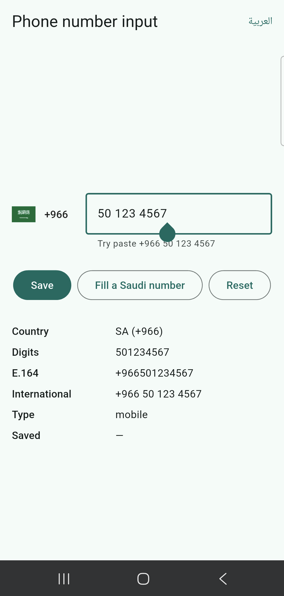
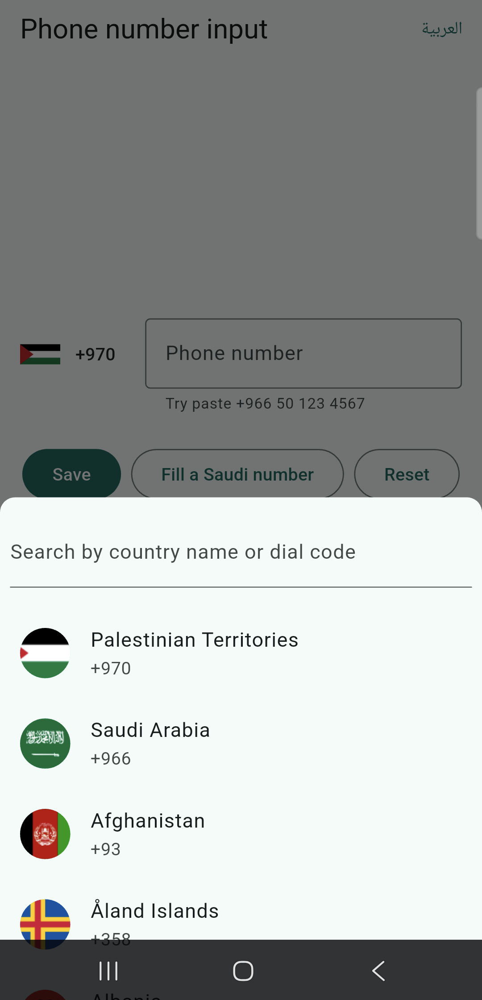
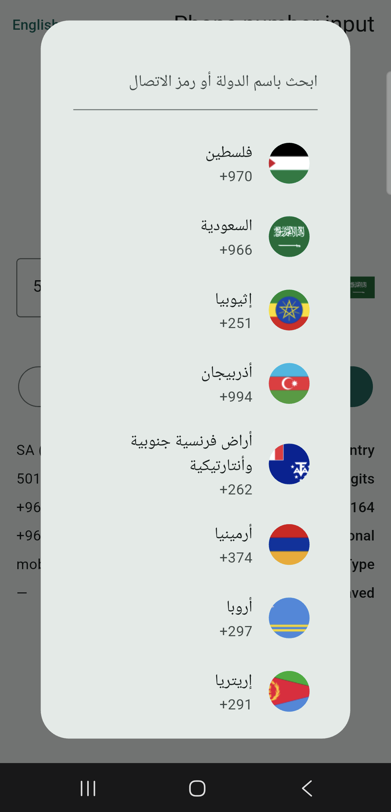

# phone_number_input

A phone number form field for Flutter with a country selector, formatting as
you type and validation by [libphonenumber](https://pub.dev/packages/dlibphonenumber),
built with first-class support for Arabic.

```dart
InternationalPhoneNumberInput(
  initialValue: PhoneNumber(isoCode: 'PS'),
  onChanged: (number) => print(number.e164), // +970599123456, or null
)
```

<table>
  <tr>
    <td></td>
    <td></td>
    <td></td>
  </tr>
  <tr>
    <td align="center">Formatting and validation</td>
    <td align="center">Country list with favorites</td>
    <td align="center">Arabic, right to left</td>
  </tr>
</table>

The screenshots come from the [example app](example/lib/main.dart).

## Features

- **Country selector** as a dropdown, a searchable bottom sheet or a dialog,
  next to the field or inside it.
- **Formatting as you type** in each country's national style, with or
  without the national prefix: `0599 123 456`, `050 123 4567`,
  `(202) 555-0123`.
- **Validation** by libphonenumber, with the result in one `PhoneNumber`
  value: country, digits, E.164 form, validity and number type.
- **Smart input**: typing or pasting `+966 50 123 4567` or `00966…` switches
  to the number's country, and the first country is the device's.
- **Arabic first**: Arabic-Indic (`٠-٩`) and Persian (`۰-۹`) digits are
  converted as they are typed, and the country search ignores letter
  variants (أ إ آ ا, ة ه, ى ي), diacritics and the article ال.
- **22 languages** for country names and texts, picked from the app's
  locale, with ways to override them or add your own.
- **Form integration** with `validator`, `onSaved` and `autovalidateMode`.
- **249 countries and territories**, with image or emoji flags.
- **Pure Dart**, so it runs on every platform Flutter supports. It depends
  only on Flutter and `dlibphonenumber`.

## Installation

```sh
flutter pub add phone_number_input
```

```dart
import 'package:phone_number_input/phone_number_input.dart';
```

## Usage

```dart
final formKey = GlobalKey<FormState>();
PhoneNumber phone = PhoneNumber(isoCode: 'PS');

Form(
  key: formKey,
  child: InternationalPhoneNumberInput(
    initialValue: phone,
    onChanged: (number) => setState(() => phone = number),
    onSaved: (number) => api.savePhone(number.e164!),
    autovalidateMode: AutovalidateMode.onUserInteraction,
    decoration: const InputDecoration(border: OutlineInputBorder()),
    selectorConfig: const SelectorConfig(
      type: PhoneInputSelectorType.bottomSheet,
    ),
  ),
);

// On submit:
if (formKey.currentState!.validate()) formKey.currentState!.save();
```

Feeding the reported number back into `initialValue`, as above, is safe: the
field keeps the text and cursor the user typed. A different `initialValue`
replaces the number, which is how to fill the field from code:

```dart
setState(() => phone = PhoneNumber.tryParse('+966501234567')!);
```

### The `PhoneNumber` value

`onChanged`, `onSaved` and `validator` all receive a `PhoneNumber`:

```dart
final number = PhoneNumber(isoCode: 'PS', digits: '0599123456');

number.isoCode;   // PS
number.dialCode;  // +970
number.digits;    // 0599123456, as typed after the dial code
number.e164;      // +970599123456, or null when it is not valid
number.isValid;   // true
number.isEmpty;   // false
number.type;      // PhoneNumberType.mobile
number.country;   // Country(PS, +970, Palestine, State of)

number.format();                           // +970 599 123 456
number.format(PhoneNumberFormat.national); // 0599 123 456
number.format(PhoneNumberFormat.e164);     // +970599123456
```

Store and send `e164`: it is the one form that identifies a number
everywhere. Two `PhoneNumber`s are equal when they have the same country and
`digits`, so `0599…` and `599…` are different values with the same `e164`.

`PhoneNumber.tryParse` reads international and national numbers, also with
Arabic digits:

```dart
PhoneNumber.tryParse('+966 50 123 4567');            // Saudi Arabia, 501234567
PhoneNumber.tryParse('00٩٦٦٥٠١٢٣٤٥٦٧');              // the same number
PhoneNumber.tryParse('0599123456', isoCode: 'PS');   // a national number
PhoneNumber.tryParse('0599123456');                  // null: no country
```

### Validation

By default, an empty field shows "Enter a phone number" and an invalid number
"Invalid phone number", in the current language. Pass `allowEmpty: true` for
an optional field, or a `validator` for your own rules:

```dart
InternationalPhoneNumberInput(
  validator: (number) {
    if (!number.isValid) return 'Invalid phone number';
    if (number.type != PhoneNumberType.mobile) return 'Enter a mobile number';
    return null;
  },
)
```

### Countries

```dart
InternationalPhoneNumberInput(
  // Only these countries can be chosen.
  countries: const ['PS', 'LB', 'JO', 'SA', 'AE'],
  // These come first in the list, in this order.
  favoriteCountries: const ['PS', 'SA'],
)
```

Without an `initialValue`, the field starts with the device's country, then
the first favorite, then the first country. The list is sorted by the names
in the current language; pass `SelectorConfig.countryComparator` to sort it
differently.

Countries can also be looked up directly:

```dart
Countries.byIsoCode('PS');    // Palestine
Countries.byDialCode('+966'); // Saudi Arabia
Countries.byDialCode('+1');   // United States, the main country of +1
Countries.filter(['PS', 'LB']);
Countries.all;                // all 249

final palestine = Countries.byIsoCode('PS')!;
palestine.localizedName(const Locale('ar')); // فلسطين
palestine.flagEmoji;                         // 🇵🇸
```

### The selector

```dart
const SelectorConfig(
  type: PhoneInputSelectorType.bottomSheet, // dropdown, bottomSheet or dialog
  showFlags: true,
  useEmoji: false,          // emoji flags instead of the bundled images
  asPrefixIcon: false,      // inside the text field instead of next to it
  spacing: 12,              // between the selector and the field
  leadingPadding: 0,
  trailingSpace: true,      // pads short dial codes like +1
  textStyle: null,          // of the dial code
  searchDecoration: null,   // of the search field
  autofocusSearch: false,
  isScrollControlled: true, // of the bottom sheet
  useSafeArea: false,       // of the bottom sheet
  dropdownMaxHeightFactor: 0.75, // of the screen height; null for no limit
  countryComparator: null,
)
```

### Input

| Parameter | Default | Description |
|---|---|---|
| `formatInput` | `true` | Formats as you type. When false, only digits are shown. |
| `maxDigits` | `15` | The maximum number of digits; spaces and dashes don't count. `0` means no limit. |
| `convertArabicDigits` | `true` | Converts Arabic-Indic and Persian digits to `0-9`. |
| `inputFormatters` | `null` | More formatters. They run before the digit limit and the formatting, so they see the text as typed. |
| `autofillHints` | `[AutofillHints.telephoneNumber]` | Autofilled international numbers switch the country too. |

The field also takes the usual `TextFormField` parameters: `controller`,
`focusNode`, `decoration`, `style`, `textAlign`, `textAlignVertical`,
`cursorColor`, `keyboardType`, `textInputAction`, `enabled`, `autofocus`,
`scrollPadding`, `onFieldSubmitted` and `onEditingComplete`.

`ArabicToEnglishDigitsFormatter` can be used in any other text field:

```dart
TextField(inputFormatters: const [ArabicToEnglishDigitsFormatter()]);
ArabicToEnglishDigitsFormatter.convert('٠٥٩٩'); // 0599
```

## Languages

Country names and texts follow the `locale` parameter or, by default, the
app's locale.

Texts are built in for Arabic, Chinese (Simplified and Traditional), Dutch,
English, French, German, Greek, Hindi, Indonesian, Italian, Japanese, Korean,
Norwegian, Persian, Polish, Portuguese, Romanian, Russian, Slovak, Spanish,
Turkish and Urdu. Country names are translated into most of these, and into
Cantonese, Northern Sami and Serbian. Other languages use English.

To change the texts of one input, for example with your app's own
translations:

```dart
InternationalPhoneNumberInput(
  strings: PhoneInputStrings(
    hint: l10n.phoneHint,
    invalidNumber: l10n.phoneInvalid,
    requiredNumber: l10n.phoneRequired,
    searchLabel: l10n.countrySearch,
  ),
)
```

To add a language, or replace a built-in one, for every input, register its
texts once, e.g. in `main`:

```dart
PhoneInputStrings.register(
  const Locale('sw'),
  const PhoneInputStrings(
    hint: 'Nambari ya simu',
    invalidNumber: 'Nambari ya simu si sahihi',
    requiredNumber: 'Weka nambari ya simu',
    searchLabel: 'Tafuta kwa jina la nchi au msimbo',
  ),
);

// Change one text and keep the others.
PhoneInputStrings.register(
  const Locale('ar'),
  PhoneInputStrings.of(const Locale('ar')).copyWith(hint: 'رقم الجوال'),
);
```

Texts that are not given are in English. A more specific locale wins, so
`Locale('pt', 'BR')` texts are used over `Locale('pt')` ones.

## Testing

`PhoneInputKeys` holds the keys of the widgets inside the input:

```dart
await tester.enterText(find.byKey(PhoneInputKeys.textField), '0599123456');
await tester.tap(find.byKey(PhoneInputKeys.selectorButton));
await tester.pumpAndSettle();
// The bottom sheet and dialog selectors have a search field.
await tester.enterText(find.byKey(PhoneInputKeys.searchField), 'palestine');
await tester.tap(find.byKey(PhoneInputKeys.countryItem('PS')));
```

## Good to know

- The digits are those after the dial code. For the territories that share
  `+1`, the dial code includes the area code, e.g. `+1264` for Anguilla, so
  the user types the remaining 7 digits.
- Some numbers are valid in several countries. libphonenumber reports all
  `+212` numbers as Moroccan, even those also valid in Western Sahara, so a
  pasted `+212…` number selects Morocco unless Western Sahara is selected.
- Phone numbers are always written left to right, also in right-to-left
  layouts.

## Migrating from intl_phone_number_input

This package started as a fork of
[intl_phone_number_input](https://pub.dev/packages/intl_phone_number_input)
and has a new API:

| intl_phone_number_input | phone_number_input |
|---|---|
| `onInputChanged` | `onChanged` |
| `onInputValidated` | `number.isValid` in `onChanged` |
| `validator: (String?)` | `validator: (PhoneNumber)` |
| `ignoreBlank` | `allowEmpty` |
| `errorMessage`, `hintText` | `strings`, `validator`, `decoration` |
| `isEnabled`, `autoFocus`, `autoValidateMode` | `enabled`, `autofocus`, `autovalidateMode` |
| `keyboardAction`, `textFieldController`, `inputDecoration`, `textStyle` | `textInputAction`, `controller`, `decoration`, `style` |
| `inputBorder` | `decoration: InputDecoration(border: …)` |
| `maxLength` | `maxDigits` |
| `onSubmit` | `onEditingComplete` |
| `selectorTextStyle`, `searchBoxDecoration`, `autoFocusSearch`, `countrySelectorScrollControlled`, `spaceBetweenSelectorAndTextField` | `SelectorConfig.textStyle`, `.searchDecoration`, `.autofocusSearch`, `.isScrollControlled`, `.spacing` |
| `SelectorConfig.selectorType`, `.setSelectorButtonAsPrefixIcon`, `.useBottomSheetSafeArea` | `SelectorConfig.type`, `.asPrefixIcon`, `.useSafeArea` |
| `PhoneInputSelectorType.DROPDOWN`, `BOTTOM_SHEET`, `DIALOG` | `.dropdown`, `.bottomSheet`, `.dialog` |
| `PhoneNumberType.MOBILE`, … | `PhoneNumberType.mobile`, … |
| `PhoneNumber.phoneNumber` | `PhoneNumber.e164` and `PhoneNumber.digits` |
| `PhoneNumber(phoneNumber: …, isoCode: …)` | `PhoneNumber(isoCode: …, digits: …)` or `PhoneNumber.tryParse(…)` |
| `PhoneNumber.getRegionInfoFromPhoneNumber(…)` | `PhoneNumber.tryParse(…)`, synchronous |
| `PhoneNumber.getParsableNumber(…)`, `parseNumber()` | `number.format(…)` |
| `PhoneNumber.getPhoneNumberType(…)` | `number.type` |
| `PhoneNumber.getISO2CodeByPrefix(…)` | `Countries.byDialCode(…)?.alpha2Code` |
| `TestHelper.TextInputKeyValue`, … | `PhoneInputKeys.textField`, … |

## Credits

Based on [intl_phone_number_input](https://github.com/natintosh/intl-phone-number-input)
by Ogunye Nathaniel Oluwatobiloba. Phone number data from libphonenumber,
through [dlibphonenumber](https://pub.dev/packages/dlibphonenumber).

## License

MIT, see [LICENSE](LICENSE).
